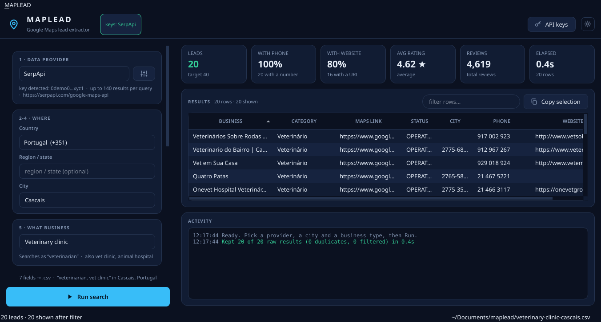
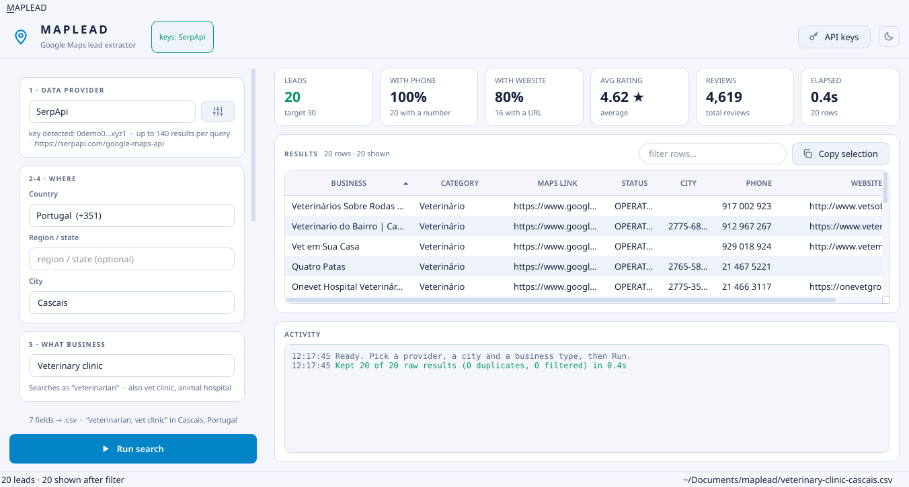
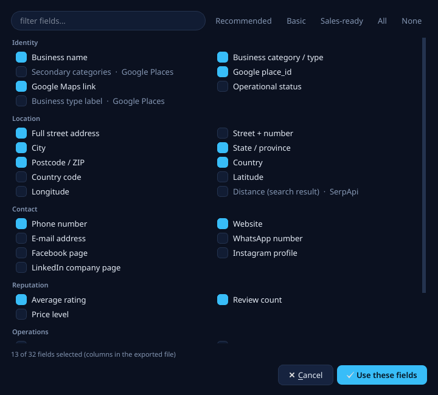
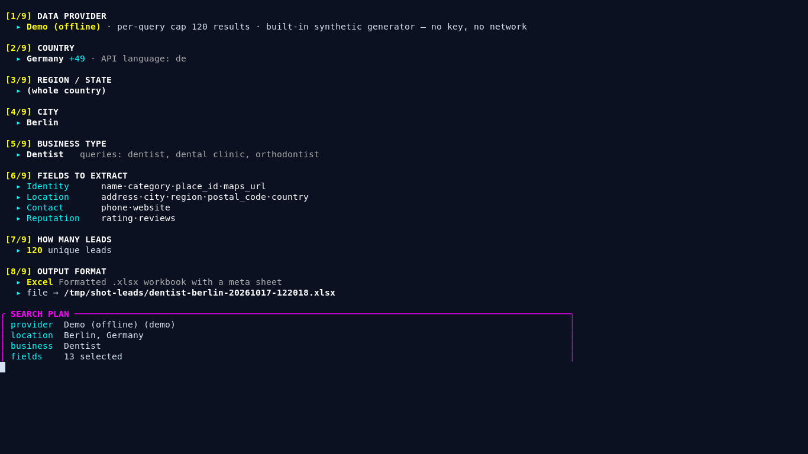
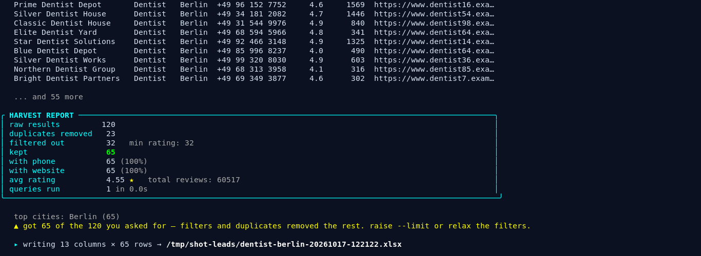

# MAPLEAD

**Google Maps lead extractor — desktop apps for Linux and Windows plus a
terminal wizard, one engine.**

Nine questions, one spreadsheet. Pick a provider, a city, a business type and how
many leads you want; MAPLEAD pulls local businesses out of Google Maps through a
lead-scraper API and writes them to CSV / Excel / JSON / TXT / TSV / HTML.



| | |
|---|---|
| 🖥️ **Desktop app** | Qt6 window, one file, nothing to install — [`MAPLEAD-x86_64.AppImage`](docs/GUIDE.md#1-get-the-app) |
| 🪟 **Windows** | portable `MAPLEAD.exe` + `maplead-cli.exe` in one ZIP, no admin — [`install.ps1`](docs/GUIDE.md#1-get-the-app) |
| ⌨️ **Terminal wizard** | pure standard-library Python, no dependencies at all |
| 🔌 **4 providers** | Outscraper · Google Places · SerpApi · DataForSEO (+ an offline demo) |
| 🧭 **65 countries / 1044 cities** | typed, filtered, auto-completed — no spelling games |
| 🏷️ **68 business types · 35 fields** | you choose exactly which columns come out |
| 📄 **6 export formats** | csv · xlsx · json · txt · tsv · html |

<p align="center">
  <a href="docs/screenshots/app-light.png"></a>
  <a href="docs/screenshots/fields.png"></a>
</p>

---

## 1 · Get the app

**Linux x86_64, AppImage** — one file, no packages, no root:

```bash
chmod +x MAPLEAD-1.1.0-x86_64.AppImage
./MAPLEAD-1.1.0-x86_64.AppImage
```

Building it yourself (also fine for arm64/other distros with a rebuild):

```bash
git clone https://github.com/DariusDev16/maplead.git
cd maplead
./build-appimage.sh --install     # writes ~/Apps/, adds it to your PATH and menu
```

> No FUSE on your system? The launcher handles it: it unpacks the image once into
> `~/.maplead-runtime/` and runs from there. No root, no loop device.

**Windows 10/11 x64, portable ZIP** — unpack it, run the installer, done:

```powershell
Expand-Archive MAPLEAD-1.1.0-win64.zip -DestinationPath "$env:LOCALAPPDATA\Programs"
cd "$env:LOCALAPPDATA\Programs\MAPLEAD"
powershell -ExecutionPolicy Bypass -File .\install.ps1
```

That adds a **MAPLEAD** entry to the Start Menu and `maplead` to your PATH; it needs
no admin rights and uninstalls from *Apps & features*. Prefer it fully portable?
Skip `install.ps1` and double-click `MAPLEAD.exe`.

`MAPLEAD.exe` is the desktop app; `maplead-cli.exe` — or just `maplead`, once the
installer has run — is the terminal wizard with the same flags as `maplead.py`.
SmartScreen may warn on first launch because the build is unsigned:
*More info → Run anyway*.

Building it yourself:

```powershell
git clone https://github.com/DariusDev16/maplead.git
cd maplead
.\build-windows.ps1 -Install      # writes %USERPROFILE%\Apps\MAPLEAD-<version>-win64.zip
```

## 2 · Add an API key

MAPLEAD never scrapes Google directly — it talks to a lead-scraper API you pay for
(or a free trial of). In the app: **API keys…** (top right) → paste → **Save & verify**
(it makes a real request before saving). Keys live in the per-user config folder:
`~/.config/maplead/.env` on Linux, `%APPDATA%\maplead\.env` on Windows (mode 600 /
an ACL-protected profile folder).

| id | service | env var | per query | e-mail / socials |
|---|---|---|---|---|
| `outscraper` | [Outscraper](https://outscraper.com) | `OUTSCRAPER_API_KEY` | ~200 | ✅ (paid enrichment) |
| `google` | [Google Places API (New)](https://developers.google.com/maps/documentation/places/web-service) | `GOOGLE_MAPS_API_KEY` | 60 | ❌ |
| `serpapi` | [SerpApi](https://serpapi.com/google-maps-api) | `SERPAPI_API_KEY` | ~140 | ❌ |
| `dataforseo` | [DataForSEO](https://dataforseo.com/apis/google-maps-api) | `DATAFORSEO_LOGIN` + `…_PASSWORD` | ~300 | ❌ |
| `demo` | built in | – | 120 | ✅ (synthetic) |

**No key yet?** Run it in **Demo** mode: synthetic leads, no network, nothing to pay —
perfect to try the whole thing first.

## 3 · Run a search

Fill the form on the left, press **Run search** (or `Ctrl+R`), watch the activity log.
Results land in a sortable grid; double-click a row to open it in Google Maps,
right-click to copy it straight into Sheets.



Everything is filtered *after every batch*, so a strict `--min-rating` still fills
your quota, and duplicates are removed on `place_id` (falling back to name + address).

## 4 · Get the file

Files land in your Documents folder — `~/Documents/maplead/` on Linux,
`%USERPROFILE%\Documents\maplead\` on Windows — with a timestamped name.
**xlsx** has a frozen header, auto-filter and a `Meta` sheet with the search parameters;
**csv/tsv** are UTF-8 (BOM, so Excel keeps the accents); **json** keeps types and arrays.



---

## Terminal wizard

Same engine, zero dependencies, Python 3.9+:

```bash
./maplead.py              # guided: 9 questions
./maplead.py --api        # set + verify an API key
./maplead.py --demo       # try it with no key at all
./maplead.py --gui        # …or open the desktop app

# scriptable
./maplead.py --demo \
  --country "United States" --region "Texas" --city "Austin" \
  --business "plumber" --fields sales --limit 150 --format xlsx \
  --min-rating 4.2 --require-phone --skip-closed --out leads/austin.xlsx
```

| flag | meaning |
|---|---|
| `-k`, `--api` | key setup: paste, verify live, save |
| `--check-keys` / `--remove-keys` | test / wipe stored keys |
| `--provider` | force a provider instead of auto-detecting |
| `--country` `--region` `--city` | location (`DE`, `Germany`, `deutschland`…) |
| `--business` | vertical or free text (`"solar installer"`) |
| `--fields` | `name,phone,rating` · `rec` · `basic` · `sales` · `all` |
| `--limit` `--format` `--out` `--outdir` | volume and destination |
| `--min-rating` `--min-reviews` | quality filters |
| `--require-phone` `--require-website` `--skip-closed` | hard filters |
| `--enrich` | Outscraper contact enrichment (costs credits) |
| `--gui` | launch the desktop app |
| `--doctor` | print environment diagnostics (for bug reports) |

The same wizard ships as `maplead-cli.exe` in the Windows ZIP, so nothing has to be
installed first:

```powershell
.\maplead-cli.exe --demo      # no key, no network
.\maplead-cli.exe --gui       # hands over to MAPLEAD.exe
.\maplead-cli.exe --doctor    # what this build thinks your Windows looks like
```

---

## Screenshots

| | |
|---|---|
|  |  |
| Empty first run — Demo mode is ready before you add a key | Keys window: paste, verify, save |

More detail in **[docs/GUIDE.md](docs/GUIDE.md)** (user guide) and
**[docs/DEVELOPMENT.md](docs/DEVELOPMENT.md)** (architecture, build, release).

## Status

Linux (AppImage) and Windows 10/11 x64 (portable ZIP) are packaged and tested in CI.
The terminal wizard runs anywhere Python 3.9+ does. macOS packaging is on the roadmap.

## Legal

Lead data returned by these APIs is public business information. Respect each
provider's terms and rate limits, and your GDPR/LGPD/PCCB obligations before
cold-contacting anyone. MAPLEAD never edits Google Maps — it only reads what the
provider APIs already expose.

## License

[MIT](LICENSE) © 2026 MAPLEAD contributors.