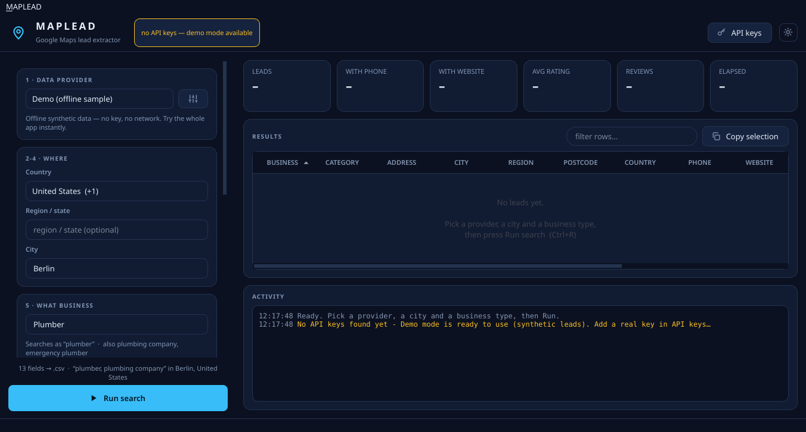
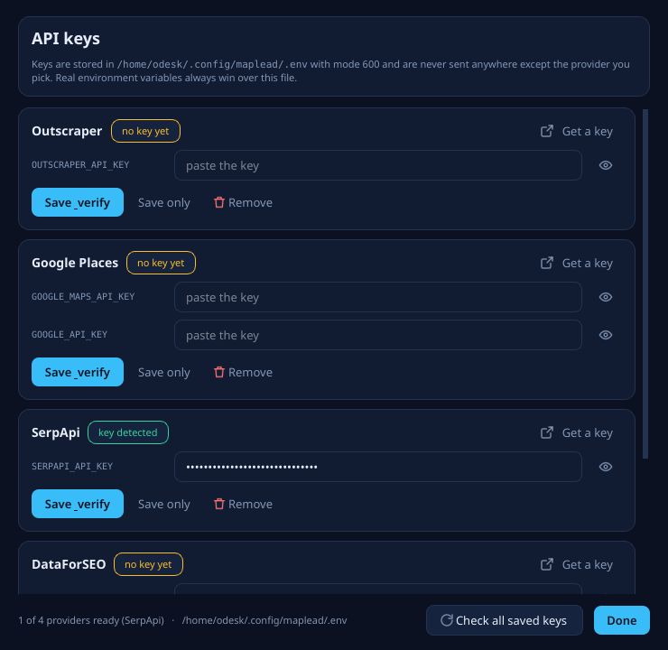

# MAPLEAD — User guide

Everything the app can do, in the order you will meet it.
New here? Read this once, then the [README](../README.md) is just a reminder.

- [1 · Get the app](#1--get-the-app)
- [2 · The first launch](#2--the-first-launch)
- [3 · API keys](#3--api-keys)
- [4 · The search form, field by field](#4--the-search-form-field-by-field)
- [5 · Running a search](#5--running-a-search)
- [6 · Reading the results](#6--reading-the-results)
- [7 · The export file](#7--the-export-file)
- [8 · Terminal wizard](#8--terminal-wizard)
- [9 · Where files live](#9--where-files-live)
- [10 · Troubleshooting](#10--troubleshooting)

---

## 1 · Get the app

### Linux (x86_64, AppImage)

```bash
chmod +x MAPLEAD-1.0.0-x86_64.AppImage     # first time only
./MAPLEAD-1.0.0-x86_64.AppImage
```

After `./build-appimage.sh --install` you can also just type `maplead`, and the app
appears in your application menu as **MAPLEAD**.

### Windows (x64, zip)

1. unzip `MAPLEAD-1.0.0-win64.zip` anywhere (Desktop is fine);
2. double-click **`maplead.exe`**.

There is no installer and nothing is written to the registry: the app runs from the
folder it lives in, so you can also put it on a USB stick. `build-windows.ps1
-Install` copies it to `%LOCALAPPDATA%\Programs\maplead` and adds a **MAPLEAD**
Start-menu entry.

Windows may show a blue *SmartScreen* prompt the first time (unsigned
executables always do): **More info → Run anyway**. After the first launch Windows
usually learns the file and stops asking. The antivirus may also flag a fresh
unsigned `maplead.exe` for a few minutes — it is a false positive from
PyInstaller's bootloader, not a real detection.

Both builds bundle Qt and everything else they need: Python is **not** required.

### If FUSE is missing on Linux

Older AppImages mount themselves through `libfuse.so.2`. If your system only ships
FUSE 3 (or none at all), the `maplead` launcher notices and unpacks the image once
into `~/.maplead-runtime/`, then runs it from there — no root, no loop device.

## 2 · The first launch



The app opens in **Demo** mode when no API key is configured: synthetic leads, no
network, no cost. Use it to learn the interface, and switch providers later without
losing anything — the form, the window size and the theme are remembered between runs.

## 3 · API keys



**API keys…** in the top-right corner opens the key manager. One row per provider:

| what | why |
|---|---|
| **Get a key** | opens that provider's dashboard in your browser |
| the masked field | paste the key (or the login *and* password, for DataForSEO) |
| **Save & verify** | saves, then makes a **real API call** to prove the key works |
| **Save only** | saves without spending a credit |
| **Remove** | clears the key from the config file |
| **Check all saved keys** | re-tests everything that is configured |

Keys are written to `~/.config/maplead/.env` with mode `600`, and are only ever sent
to the provider you pasted them for. Real environment variables always win over that
file, so exporting `SERPAPI_API_KEY=…` in your shell works too.

## 4 · The search form, field by field

| step | control | notes |
|---|---|---|
| 1 | **Data provider** | auto-selects a configured one; shows the key state, the per-query cap and the provider homepage |
| 2-4 | **Where** | country (65, type to filter) → region (with completion) → city (1044 catalogued, type anything) |
| 5 | **What business** | 68 verticals with the phrases they are actually searched as, or free text |
| 6 | **Fields** | 35 fields, grouped and searchable, with `rec` / `basic` / `sales` / `all` presets |
| 7 | **How many + filters** | target volume, min rating, min reviews, phone/website required, skip closed, enrichment |
| 8 | **Export** | csv · xlsx · json · txt · tsv · html, plus the destination path |

Two things worth knowing:

- **Pick the region and the city list narrows to it.** Leave the region empty to
  search the whole country.
- **Fields your provider cannot return are locked**, with the reason shown
  (`· Outscraper`, `· Google Places`…). E-mail and social profiles need Outscraper.

## 5 · Running a search

Press **Run search** or `Ctrl+R`. While it runs:

- the progress bar and the activity log show every query, how many raw results came
  back and how many survived the filters;
- the form is locked so a run cannot be corrupted by a stray click;
- **Stop** (`Ctrl+R` again, or the button) finishes the current query and keeps what
  it already collected — the file is still written.

Because a text query returns at most 60 places from Google (and a few hundred from
the other providers), MAPLEAD widens the net with query variants — synonyms from the
vertical catalogue, `near <location>`, per-district phrasing — until your target is
reached or the variants run out.

## 6 · Reading the results

- **Stat tiles** — leads found vs. target, share with a phone, share with a website,
  average rating, total reviews, elapsed time.
- **Grid** — click any column header to sort; the **filter rows…** box searches every
  visible column at once.
- **Double-click** a row to open that business in Google Maps.
- **Right-click** a row: copy cell, copy row, copy row as TSV (paste straight into
  Sheets/Excel), copy selection as spreadsheet text, open in Maps, open website, or
  search the phone number online.
- **Copy selection** copies the highlighted rows (all columns) to the clipboard.

## 7 · The export file

| format | what you get |
|---|---|
| **xlsx** | real Excel workbook: frozen header, auto-filter, sized columns, numbers as numbers, plus a `Meta` sheet with every search parameter |
| **csv** / **tsv** | UTF-8 with BOM, so Excel and Sheets keep accents and tabs |
| **json** | `{meta, columns, count, leads[]}` with types preserved |
| **txt** | one readable block per lead |
| **html** | dark report with links and star ratings — open it in any browser |

Exactly the fields you selected become columns (unless you picked "everything").

## 8 · Terminal wizard

The original interface, still fully supported and dependency-free:

```bash
./maplead.py --api     # set + verify a key
./maplead.py           # guided
./maplead.py --demo    # no key needed
./maplead.py --gui     # open the desktop app
```

Guided mode shows long lists side by side, sized to your terminal, so the 65
countries and 68 verticals fit on one screen; every list is filterable by typing,
and the field picker understands `1,3-5` ranges and `all` / `none` / `rec`.

Environment switches: `MAPLEAD_NO_COLOR=1`, `MAPLEAD_ASCII=1` (plain output),
`MAPLEAD_DEBUG=1` (full tracebacks).

## 9 · Where files live

| what | Linux | Windows |
|---|---|---|
| keys | `~/.config/maplead/.env` (mode 600) | `%APPDATA%\maplead\.env` |
| exports | `~/Documents/maplead/` | `%USERPROFILE%\Documents\maplead\` |
| window state / theme | `~/.local/share/maplead/` | `%LOCALAPPDATA%\maplead\` |
| unpacked AppImage (no FUSE) | `~/.maplead-runtime/` | — |

Nothing is written inside the project folder or the application bundle. A legacy
`.env` sitting next to `maplead.py` still works and takes precedence, so command-line
installs keep reading the file they always read.

## 10 · Troubleshooting

| symptom | cause / fix |
|---|---|
| `dlopen(): error loading libfuse.so.2` | your Linux has no FUSE 2 — run the `maplead` launcher (not the `.AppImage` directly), or `APPIMAGE_EXTRACT_AND_RUN=1 ./MAPLEAD-….AppImage` |
| Windows: "Windows protected your PC" | SmartScreen on an unsigned build → **More info → Run anyway** |
| Windows: the exe is quarantined by Defender | false positive from PyInstaller's bootloader; allow/restore it, or build it yourself with `build-windows.ps1` |
| Windows: the app opens as a black console | you ran `maplead.exe --selftest`; that is the self-check, close it |
| `maplead.exe --selftest` shows a dialog | expected in a windowed build: the report is written to `%TEMP%\maplead-selftest.log` |
| blank window / wrong colours | force a theme: `maplead --theme dark` or `--theme light` |
| "no API keys — demo mode available" | expected until you add one in **API keys…** |
| `API key not valid` | the key is wrong for that API — paste the right one (Google's key must have **Places API (New)** enabled and billing on the project) |
| `403` | key rejected: check plan/quota on the provider dashboard |
| `429` | rate limited: wait a minute and run again |
| "got 60 of the 150 you asked for" | Google caps a text query at 60 results; ask for a bigger limit (more query variants run) or a wider city/region |
| nothing matched | relax the filters first: drop `--min-rating`, un-tick "only with phone", then try another city spelling |
| window opens bigger than the screen | it self-corrects now; if it persists, delete the state dir (`~/.local/share/maplead` / `%LOCALAPPDATA%\maplead`) and restart |
| nothing happens on double-click (Linux) | your file manager may not allow executing it — run it from a terminal once, or use the menu entry |

Still stuck? Open an issue with the output of `maplead --selftest` and
`maplead --check-keys`.